# ActiveLook Layout Overview

This overview shows the available ActiveLook layout variants with example values for preflight, inflight, and postflight.
You can change them via the Suite Menu "Settings - ActiveLook".

These are just examples
Each active slot in the preflight, inflight, and postflight displays can be configured with one of these values:

| Value | Key |
| --- | --- |
| Off | `off` |
| Flight Mode | `flightmode` |
| Timer | `timer` |
| Governor | `governor` |
| Arm Status | `armed` |
| ESC Temp | `temp_esc` |
| MCU Temp | `temp_mcu` |
| Link | `link` |
| Fuel | `fuel` |
| Current | `current` |
| Voltage | `voltage` |
| Cell Voltage | `cell_voltage` |
| Headspeed | `headspeed` |
| Consumed mAh | `consumption` |
| Max ESC Temp | `temp_esc_max` |
| Max MCU Temp | `temp_mcu_max` |
| Min Link | `link_min` |
| Max Link | `link_max` |
| Min Fuel | `fuel_min` |
| Max Fuel | `fuel_max` |
| Min Current | `current_min` |
| Max Current | `current_max` |
| Min Voltage | `voltage_min` |
| Max Voltage | `voltage_max` |
| Min Headspeed | `headspeed_min` |
| Max Headspeed | `headspeed_max` |

| Layout | Preflight | Inflight | Postflight |
| --- | --- | --- | --- |
| Single Centered | 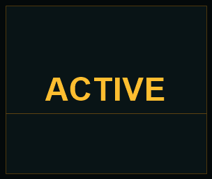 | 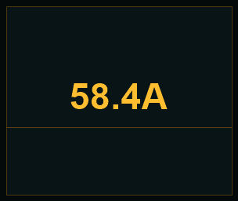 | 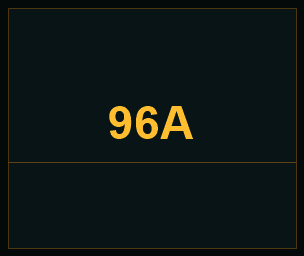 |
| One Top + Two Bottom | 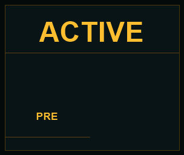 | 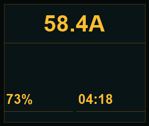 | 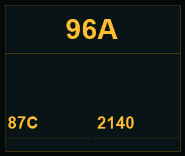 |
| Stacked Large + Large + Small | 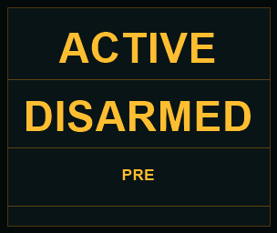 | 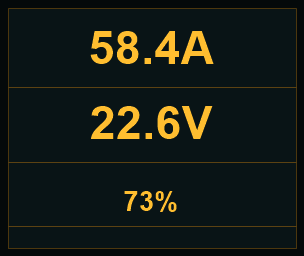 | 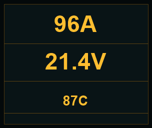 |
| Two Top + One Bottom | 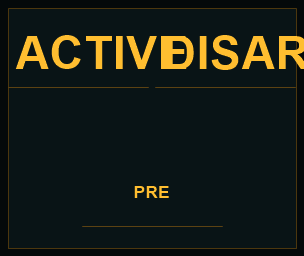 | 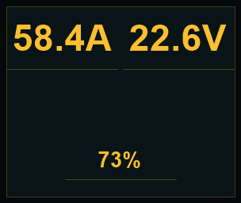 | 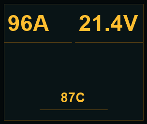 |
| Two Top + Two Bottom | 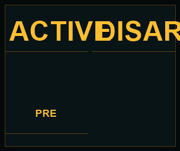 | 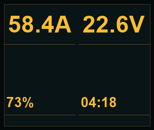 | 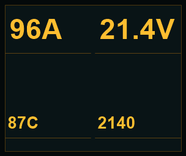 |
