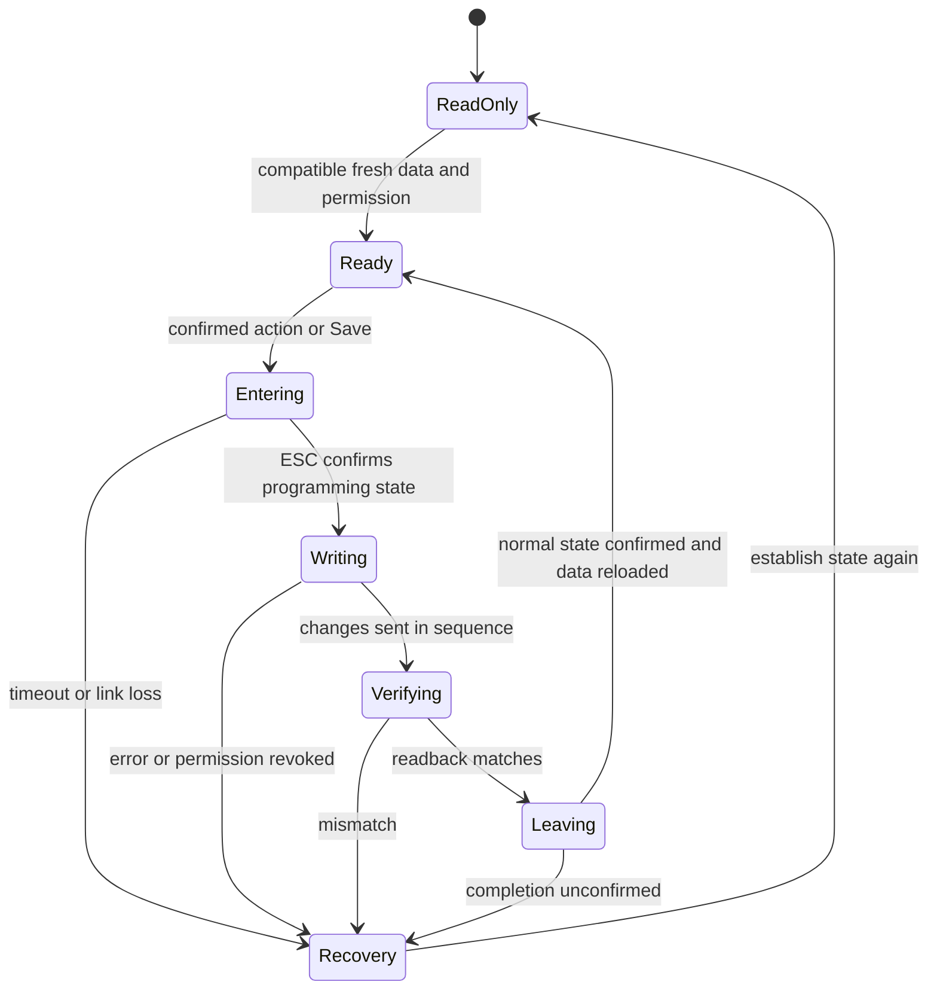

# KONTRONIK K-PROG 1.5 analysis and application to the ETHOS Suite

Date: 2026-11-10. The supplied APK was examined statically. This document separates observed application behaviour from recommendations for the Rotorflight ETHOS Suite. It does not specify an implemented communication interface.

## Findings

The dependencies relevant to the existing Kontronik fields can be represented in the Suite. Three separate layers are required:

1. **Field availability:** battery chemistry, ESC governor, brake, EEPROM version and controller capabilities determine which controls are relevant.
2. **Write transaction:** programming permission, the actual ESC state and valid parameters determine whether a write is allowed. An enabled widget is insufficient.
3. **Transport:** the APK communicates directly over Bluetooth SPP. The Suite communicates through Rotorflight/MSP. The Android application defines neither our MSP codec nor its payload.

The APK provides useful evidence of relationships, but **must not be copied as an unconditional specification**. It contains older limits, a single pending-message slot and automatic follow-up writes. Several values conflict with the supplied protocol documentation dated 2026-04-01.

## Scope and provenance

- File: `Kontronik K-PROG 1.5.apk`, 336496 bytes.
- SHA-256: `8537ed2b324ae7d953ac8ed82066deed52474a75f1101cef1e4f019c835658a3`.
- Package: `com.kontronik.k_prog`; manifest and `BuildConfig`: version `1.5`, code `10500`, release build, Android minSdk 10 / targetSdk 26.
- Static decompilation with JADX 1.5.6, supplemented by raw DEX instructions for problematic control-flow sections.
- The APK was not executed. No ESC connection, write attempt or real communication capture was performed.
- The APK and decompiled sources were not added as project assets. The hash identifies the examined file; it does not authenticate its publisher.
- Compared against `src/rfsuite/app/pages/esc_forward_kontronik.lua`, `esc_forward_vendor.lua` and the previously examined `KONTRONIK_Bluetooth_Doc_20260401_BW.pdf`.

### Evidence references

References identify methods in `classes.dex`, package `com.kontronik.k_prog`. XML paths refer to decoded Android resources. This makes the evidence independent of temporary local directories.

| Reference | Class / method or resource | Subject |
| --- | --- | --- |
| A1 | `BTManager`: `SPP_UUID`, `ConnectThread`, `ConnectedThread.run/write` | Connection and bytes |
| A2 | `MainActivity`: `procHandler`, `timerTask500ms`, `extractData` | Reception, permission, pending message |
| A3 | `MainActivity`: `initBTProgramming`, `finishBTProgramming`, both `sendToRegler` overloads | Write commands |
| A4 | `MainActivity`: `batteryTabEditController`, `motorTabEditController`, `positionEditController`, `intEditController`, `alarmTabEditController` | Input, limits and scaling |
| A5 | `MainActivity`: `OnClick_ModelType`, `dlgLoadDefaultsClickListener` | Default parameter sets |
| A6 | `MainActivity`: `updateUI`, `maskUI`, `OnClick_BtnExpert` | Visibility and model masks |
| A7 | `MainActivity`: `OnClick_CBRPMcontrol`, `adjustData`, `testCRC`, `calcChecksumme` | Follow-up changes and checksum |
| A8 | `MainActivity`: `checkStickPositions`, `OnClick_BtnSetPosition`; `Util.checkPos` | RC endpoints |
| A9 | `ReglerSettings`: `extractBitStatusFromBitStatusWord`, `generateBitStatusWordFromBitStatus`; `Bit_Status` | Shared status word |
| A10 | `MainActivity`: `OnClick_RBTelKonfig1/2`, controller identification in `extractData` | Telemetry outputs and controller types |
| A11 | `res/layout/{battery,motor,radio,alarm,model}_layout.xml`, `res/values/strings.xml` | UI structure and wording |

The normal Java decompilation of `extractData()` contains duplicated blocks and misleading conditions. Critical findings were checked against raw DEX instructions: the condition `RegTyp == 3 OR RegTyp == 4`, the inclusive state range 7-17 and calls to `adjustData()` after successful checksum validation. Decompiled Java is not compilable original source and does not prove that the application actually contains infinite loops.

## 1. Connection, reception and EEPROM model

The application uses Classic Bluetooth SPP/RFCOMM, not BLE-GATT. Its UUID is `00001101-0000-1000-8000-00805F9B34FB`. It opens a `createInsecureRfcommSocketToServiceRecord` socket and writes text to the output stream. Incoming bytes are decoded using `ISO-8859-15`. [A1]

The receive thread uses a 2048-byte buffer and sleeps for 50 ms after a read. This is not a guaranteed telegram interval. A handler accumulates fragments; when the existing text exceeds 2500 characters it discards that buffer. Boundaries are identified by `\n` and the last preceding `§` marker, byte `0xA7`, rather than Bluetooth read boundaries. [A1, A2]

| Block | Observed use in APK 1.5 |
| --- | --- |
| `§G` | Current receiver pulse length, displayed and usable for capturing an RC endpoint |
| `§R` | Controller name `--R`, permission `--P`, operating state with text ID `20` |
| `§E` | EEPROM values paired with encoded parameter pointers |

The newer PDF specifies additional event and measurement blocks. A complete corresponding event/live-telemetry display is not established by this APK. The Suite's prepared status list uses the PDF as its source for those fields.

An EEPROM entry supplies `value:pointer;`. The application stores both the value, such as `UBEC_soll`, and its received pointer `pUBEC_soll`, then uses that pointer for writing. This does **not** establish a universal table of fixed addresses. Assignment depends on entry position, controller family and EEPROM version. [A2, A3]

- Common initial entries: `cbSize`, `bcdVersion`, `BitStatusWord`, three cell cutoff voltages and further parameters.
- KOSMIK/JIVE branch, `RegTyp 1`: `PWM_min` starts at position 24. EEPROM `0x0400` places the checksum at position 32. With `0x0401`, six alarm values occupy those positions and the checksum follows at position 38.
- KOLIBRI/UHV branch, `RegTyp 3/4`: additional `frei0/frei1` entries at positions 24/25 shift `PWM_min` to position 26, alarms to positions 34-39 and the checksum to position 40.

These application assumptions do not automatically cover later firmware. Before writing, Rotorflight must provide a recognised, complete layout including valid pointers.

## 2. How a parameter change works

### Individual writes rather than Save all

Numeric fields are normally processed when focus is lost; the keyboard's Done action forces that focus change. Inputs are validated, clamped or restored to their previous text before the individual parameter is written. Checkboxes and radio buttons trigger their write handlers directly. These paths do not implement a general local draft followed by Save all. [A4]

Many numeric values are displayed again from the next received EEPROM image. `updateUI()` does not overwrite a field while it has focus. `skipUpdate()` sets a counter to 2: the handler discards the next two receive callbacks and the accumulated buffer. This is **not** evidence of two complete telegrams, nor is it a write acknowledgement. [A2, A4, A6]

### Write format

```text
$$<value>:<pointer>;<value>:<pointer>\r\n
```

The two pairs are identical. Repetition is an integrity measure. One overload calculates `(wordLength << 12) + address`; the other uses the received encoded pointer. [A3]

| Pointer type | Meaning from the PDF and its concrete use in the application |
| --- | --- |
| 2 | 16-bit parameter |
| 3 | Percentage write path; do not confuse a percentage with the received 0-4096 raw representation |
| 4 | 32-bit parameter |
| 5 | Load a complete default parameter set |
| 6 | Enter or leave programming mode |

An MSP payload may deliberately use different scaling. Its future codec contract must define this explicitly; Lua must not blindly recreate Bluetooth packets or pointers.

### Permission and actual programming state

The application distinguishes three conditions:

- `m_ProgAllowed`: `--P` permits programming and the reported operating state is in the inclusive range **7-17**.
- `m_ProgState`: the reported state is exactly **17**.
- Bluetooth connected: checked separately at the final send path.

Entry and exit use type 6, address 0: `24576 = 0x6000`.

```text
$$23:24576;23:24576\r\n
$$38:24576;38:24576\r\n
```

Both functions initially clear local permission and wait for another status report. For a change outside programming mode, the application locks the UI, stores **one** message in `m_QueuedMsg` and requests entry. A 500 ms timer sends it only when permission and state match again. Subsequent changes in programming mode are sent directly. A Start/Finish Prog. button also switches mode explicitly. [A2, A3]

These paths do not reveal dedicated per-parameter acknowledgements, transaction IDs, multiple queue entries or per-write retries/timeouts. Cyclic EEPROM reception provides readback. Even the Defaults loaded notification is displayed after calling the write path, rather than after verified completion.

**Suite requirement:** an asynchronous transaction with deadlines, cancellation on link loss/arming, readback verification and separate requested/confirmed states. The application alone does not prove whether physical EEPROM is finally persisted on each command or internally when programming mode is left.

### Checksum

`testCRC()` and `calcChecksumme()` validate received EEPROM data using additive calculations inverted with `0xFFFFFFFF`, rather than a conventional polynomial CRC. They account for 16-bit parts of 32-bit values, family layouts, reserved `0xFFFF` words and alternatives with/without RC endpoints. The two implementations are not a single universal layout-independent sum. [A7]

A `pChecksumme` pointer is sometimes stored, but the examined write handlers do not generate a new checksum write. Do not invent an extra Lua checksum command. The firmware driver and complete telegram fixtures must establish responsibility and the exact algorithm.

## 3. Shared status word

Many independent UI fields modify the same `BitStatusWord`. [A9]

| Suite field | APK mapping |
| --- | --- |
| `battery_type` | Bits 2-3: 0 NiCd/NiMH, 1 LiPo, 2 LiFePo |
| `undervoltage_behavior` | Bit 8: power reduction / shutdown |
| `rotation` | Bit 10: rotation reversal |
| `fwd_bckwd` | Bit 13: forward/reverse |
| `brake` | Bit 0: EMK brake enabled |
| `prop_brake` | Bit 1: **proportional brake**, not propeller brake |
| `rpm_ctl` | Bit 5: ESC-internal speed control |
| `how_adj_max_rpm` | Bit 6: fixed/stored target speed; bit 7 additionally reports the learned state |
| `extra_smooth_IU` | Bit 14: soft start |
| `alternate_startup` | Bit 17: ramp-based startup |
| `bt_disable_motor_renable_button` | Bit 18: disable Bluetooth, re-enable using the module button |
| `bt_disable_motor_renable_motor_stop` | Bit 19: Bluetooth off while the motor runs, available afterwards |

The two Bluetooth options are independent; the APK does not implement mutual exclusion. Other known bits include throttle curve (4), AutoTiming (9), APM (11), active freewheeling (12), receiver averaging (15) and logging (16).

**Suite requirement:** read-modify-write the entire received word and preserve unknown/non-editable bits. The Android generator reconstructs only its known bits 0-19 and would not preserve unknown higher bits. Do not copy that behaviour.

## 4. Availability and visibility dependencies

### Established rules and their ETHOS equivalents

| Trigger | Application behaviour | ETHOS implementation |
| --- | --- | --- |
| `battery_type` | One cutoff field reads/writes `U_relAb_NiMH`, `U_relAb_LiPo` or `U_relAb_LiFePo`; limits differ by chemistry | Preserve all three raw values or explicitly reload the active value. Change getter, setter target and bounds together. An unchanged shared `undervoltage_cell` is insufficient as the data model. |
| `brake == false` | `idcBrakeSettings` is hidden | Disable/hide `prop_brake` and any future brake PWM/ramp controls. Preserve inactive values. |
| `rpm_ctl == false` | `idcRPMcontrolSettings` is hidden | Disable/hide `how_adj_max_rpm`, `max_rpm`, `startuptime`, `p-gain` and `motor_resist`. |
| `rpm_ctl == true`, `how_adj_max_rpm == 0` | `idcMaxRPMSettings` is hidden | Edit `max_rpm` only with ESC speed control AND stored target mode enabled. |
| Discharge limiter off | Checkbox writes `maxDischarge = 0`; switching on writes 30, meaning 3.0 Ah | Zero means off. A separate Suite switch would be a UI abstraction, not an extra ESC boolean. The application does not disable the numeric field at zero; entering a positive number can reactivate the limiter. |
| EEPROM `0x0400` | Six alarm inputs disabled; the type-1 layout does not contain their later entries | Check capabilities. The PDF documents availability from 4.1; a numeric version comparison alone must not authorise an unknown layout. |
| Name contains `JIVE` | BEC-current alarm disabled on identification | A model capability for `max_bec_current` is needed. Multiple UI override paths exist; do not claim this is a permanently effective restriction for every firmware. |
| No programming permission / connecting | All-locked UI mask | Global write permission must dominate local unlocks. |
| Invalid RC endpoints | Finish Prog. disabled during programming, fields highlighted | Validate the combination before completion, not just independent min/max values. |
| Expert view | Extra controls visible; model mask reset to unrestricted fields | Optional discoverability aid; never a substitute for hardware/version/safety restrictions. |

These rules are evidenced by `updateUI()`, `maskUI()`, handlers and layout membership. [A4, A6, A8, A11]

The application does not impose an extra proportional-brake visibility condition on brake PWM limits beyond their common brake group. It also does not establish that Rotorflight governor settings directly enable or disable the ESC governor. Those would be additional integration decisions.

### Model masks are UI aids

After confirming a default-set load, the application applies a local mask. Expert and renewed permission can remove it. The current model type is not read from EEPROM as a conventional persistent enum. [A5, A6]

| Local mask | Brake group | ESC governor group | PWM rise/fall time | Forward/reverse | Brake/reverse endpoint |
| --- | --- | --- | --- | --- | --- |
| Unrestricted / Expert | enabled | enabled | enabled | enabled | enabled |
| Glider | enabled | disabled | enabled | disabled | enabled |
| Powered aircraft | enabled | enabled | enabled | disabled | enabled |
| Helicopter | disabled | enabled | disabled | disabled | disabled |
| Car | enabled | disabled | enabled | enabled | enabled, labelled Reverse Position |
| All locked | disabled | disabled | disabled | disabled | disabled |

These permissions are combined with visibility conditions such as `brake` and `rpm_ctl`. Battery chemistry, cutoff, pole count, gearing, minimum PWM, soft start, alternative startup, startup current, BEC and Bluetooth remain generally available in the four model masks, subject to global and model/version restrictions.

In the Suite, the last **requested** preset could at most be a local UI preference. It must not be presented as a read current model type or permanent hardware restriction. APK 1.5 has no model button or dedicated mask for F5A, which is described in the newer PDF.

## 5. ESC governor follow-up writes

`OnClick_CBRPMcontrol()` writes the status word and then calls `adjustData()`. EEPROM reception also invokes that adjustment after successful `testCRC()` validation; this is confirmed in the raw DEX instructions. Reception is therefore potentially **not read-only**. [A7]

| ESC governor | Parameter | Accepted received raw range | Value sent on mismatch |
| --- | --- | --- | --- |
| On | `Stick_PWM_min` | 1280-1536 | 33 |
| On | `Stick_L_Totzone` | 1280-1536 | 1365 |
| On | `Stick_V_Totzone` | 0 | 0 |
| Off | `Stick_PWM_min` | 40-400 | 1 |
| Off | `Stick_L_Totzone` | 1-500 | 327 |
| Off | `Stick_V_Totzone` | 1-320 | 204 |

33 and 1 are the values sent using the received `pStick_PWM_min`; they are not the same representation as the tested raw ranges. The pointer's percentage semantics are essential.

Changing `rpm_ctl` can consequently affect internal ESC parameters absent from our UI. Whether current ESC/Rotoflight versions require these adjustments must be checked in the driver and real telegrams. If required, they belong in a validated transaction in the firmware/codec layer. Opening or reading a Suite page must never start such writes.

The single `m_QueuedMsg` cannot reliably represent several follow-up commands during programming-mode entry. This is another reason not to copy the Android queue design.

## 6. Numeric fields, units and version conflicts

The application limits below describe **APK 1.5 code**, not a universal authorisation for all ESCs. The PDF column identifies differences from the 2026-04-01 documentation. A current capability specification must take precedence over copying old application limits. [A4, A6]

| Suite field | APK target / conversion | APK validation | Comparison / implementation consequence |
| --- | --- | --- | --- |
| `undervoltage_cell` | Chemistry-specific `U_relAb_*`, mV | NiMH 700-1200; LiPo 2800-4000; LiFePo 2000-3500 | PDF: LiPo 2700-3500, LiFePo 1800-2600. Resolve before real writes. |
| `discharge_limit` | `maxDischarge`; Ah = raw / 10; write Ah times 10 | Up to 100 Ah; no equally strict lower handler check; zero disables | The original preview used mAh and 0-20 incorrectly. Use validated non-negative input. The dependency implementation now uses tenths of Ah. |
| `pole_number` | `Polzahl`, actual pole count | Non-zero and even; layout limits text to two digits | Do not transmit an enum index. PDF: 2-100, steps of two. |
| `gear_ratio` | `Uebersetzung`; raw / 100, write times 100 | Float greater than zero, no complete raw upper-bound check | PDF raw range 100-65535; handle rounding and overflow explicitly. |
| `max_rpm` | `nRegMax`, direct speed | 5000-150000 | Checksum handling treats this as 32-bit. Do not inherit a U16 assumption from the old draft. PDF calls it internal, without a universal range. |
| `startuptime` | `Slew_nRegelung`; display ms / 1000, write s times 1000 | 4-60 s | Original draft 0-60 s differs from the application. |
| `p-gain` | `P_Anteil` | 2-20 | PDF: 0-10. Establish the applicable firmware version. |
| `motor_resist` | `nRegRi`, displayed in mOhm | 2-100 | PDF: 1-1000 mOhm. Application suffix validation includes a percentage-text branch; do not copy it into the Suite parser. |
| `PWM_min` | Receive 0-4096; display `floor((raw+20)*100/4096)`; write whole percent | 2-100 percent | Read and write representations differ; do not blindly transmit the received raw value. |
| `slewrate_up` | `Slew_PWM_Pos`, ms | 100-30000 | PDF: 200-60000 ms. |
| `slewrate_down` | `Slew_PWM_Neg`, ms | 100-30000 | PDF: 200-60000 ms. |
| `startup_curr_limit` | `Anlaufstrom`, A | 1-100 | PDF: 10-100 A. |
| `act_impulse_length` | `§G` measurement | No EEPROM change | Remains a read-only measurement. |
| `off_position` | `Stick_Neutral`, microseconds | 500-2500 | Additional cross-field endpoint validation is required. |
| `max_position` | `Stick_Vollgas`, microseconds | 500-2500 | Both pulse-scale directions are supported. |
| `brake_position` | `Stick_Hinten`, microseconds | 500-2500 | Reverse Position in the car UI context. |
| `bec_voltage` | `UBEC_soll`, mV | 5000-8000; otherwise restore previous text | This handler does not establish capabilities for models without a BEC. |
| `max_discharge` | `WmaxDischarge`; Ah = raw / 10 | 0-100 Ah | An alarm threshold separate from `discharge_limit`. |
| `min_input_voltage` | `WUmin`, unchanged mV | 700-4400 | PDF `W_Umin`: 12000-60000 mV. Significant semantic/version conflict; the APK does not establish an additional conversion to pack voltage. |
| `max_motor_current` | `WmaxStrom`, A | 1-400 | PDF minimum 10, maximum twice the model-specific rated current. |
| `max_esc_temp` | `WmaxTempESC`, Celsius | 50-90 | PDF: 20-100 Celsius. |
| `max_bec_temp` | `WmaxTempBEC`, Celsius | 50-90 | PDF: 20-100 Celsius. |
| `max_bec_current` | `WmaxStromBEC`; display A = mA / 1000, write A times 1000 | 0-30 A | PDF upper limit is model-specific; account for the JIVE restriction. |

Do not silently correct values on loading. A saved value outside an old application range is not an instruction to overwrite it. Display it unchanged and require an explicit correction, or disable editing until the capability is established.

## 7. RC endpoints depend on each other

The application generally accepts 500-2500 microseconds. `checkStickPositions()` additionally tests the combinations below, where `off = Stick_Neutral`, `max = Stick_Vollgas` and `brake = Stick_Hinten`. [A8]

| Case | Additional application condition |
| --- | --- |
| `max > off` | `off >= brake`; with brake enabled also `max >= brake + 200` |
| `max < off` | `off <= brake`; with brake enabled also `max <= brake - 200` |
| Either direction | At least 100 microseconds between off and max |
| `max == off` | Invalid |
| Brake enabled | Brake endpoint must also be in range |

The ordering test involving the brake endpoint is outside the extra brake-enabled condition. Do not silently reinterpret it as a different rule. Desired validation for helicopters without a brake must be checked against the supported ESC firmware.

Set Off/Max/Brake captures the current `§G` pulse after range validation. It is not a motor-start command. The Suite does not currently provide these capture actions; they could be implemented using a fresh, valid measurement.

Invalid combinations can disable Finish. The Suite must validate new endpoints as a set. An interrupted link must not leave programming state permanently unresolved: recovery is part of the driver design. The local preview now diagnoses the documented ordering/spacing while leaving controls available to repair an invalid combination.

## 8. Loading a model default set

The application asks for confirmation that previous settings will be discarded. It then sends type 5 / address 0 with value 2 for glider, 3 for powered aircraft, 4 for helicopter or 6 for car, applies a local mask and switches to the RC tab: set endpoints, then finish programming. [A5, A11]

This confirms our existing design decision: a separate target selector and confirmed load action, rather than an ordinary current-model-type field. F5A value 5 is established only by the newer PDF. Never substitute the choice-box index for the actual command value.

After real execution, the Suite must reread every parameter/endpoint and invalidate old drafts. Do not copy the Android success notification immediately after calling the send path. The local preview correctly avoids inventing complete default datasets.

## 9. Additional capabilities and values absent from our UI

For KOLIBRI/UHV, `frei0` is not an arbitrary unused zero: its lower/upper bytes configure two telemetry outputs. The application tries to prevent assigning the same non-off telemetry type to both ports. Futaba is provided only for the first port and hidden for UHV. The second KOLIBRI port is displayed only for the recognised 140 variant. [A10]

The Suite does not offer these selections. This analysis does not itself require new controls, but future EEPROM writes must preserve those values. Serialising only visible fields and zeroing the rest would be incorrect.

Identification uses the reported controller name:

| Name contains | Local family |
| --- | --- |
| `KOSMIK`, without UHV/250 | Type 1 |
| `KOSMIK` with `UHV` or `250` | Type 4 |
| `JIVE` | Type 1; BEC-current alarm additionally disabled during identification |
| `KONTROL` | Type 2 |
| `KOLIBRI` | Type 3; extra flag when the name contains `140` |

The application attempts to lock editing for families other than 1/3/4. Because several permission/mask paths can override UI state, this is not a robust capability list for all future controllers. Rotorflight must validate the supported family and payload explicitly.

The six alarm thresholds belong to the ESC. Sharing an Android tab with model-specific telemetry output settings does not turn them into Rotorflight/Suite alarm thresholds. Our **Edit ESC alarms** switch is an additional local editing lock requested by the user; APK 1.5 has no equivalent alarm unlock.

## 10. Implementation in the existing ETHOS page

### Local dependencies implemented on 2026-11-10

1. `prop_brake` is disabled while `brake` is off. Stored child values are preserved. Its English label now correctly reads Proportional brake.
2. `how_adj_max_rpm`, `max_rpm`, `startuptime`, `p-gain` and `motor_resist` follow `rpm_ctl`. `max_rpm` additionally requires stored target mode. Both widget availability and setters enforce these rules.
3. Each battery chemistry retains its own local cutoff example and uses its own getter/setter target and bounds. The preview follows the newer PDF: NiMH 700-1200 mV, LiPo 2700-3500 mV and LiFePo 1800-2600 mV. Initial examples are 800/3000/2300 mV. These are documented preview defaults, not invented ESC readings. The older APK conflicts remain unresolved for real writes.
4. Switching chemistry updates bounds and the reset/default value in place. Widget clamp callbacks during that transition are ignored, so they cannot overwrite another chemistry's saved example.
5. The local RC endpoint diagnostic implements the application's ordering and spacing conditions. It reports invalid combinations without blocking the edits needed to fix them. It does not claim to validate an actual programming-mode completion.
6. The discharge limit is now displayed in tenths of Ah, with zero representing off. As in the APK, the numeric field remains editable; no additional limiter boolean or automatic 3.0 Ah write is introduced.
7. The existing event/status order and the alarm panel's final position remain unchanged. The local alarm unlock defaults to off and cannot bypass disabled setters. Firmware-dependent capabilities are not fabricated from the requested preset or placeholder status.

Preset selection still does not imply a current model type. Local Android model masks are not applied from an unexecuted preset request. No governor helper writes, Bluetooth operations or MSP messages are introduced.

### Requires authoritative firmware data

- Global permission derived from connection, arming, fresh ESC status, compatible signature/version and actual write readiness.
- EEPROM/model capabilities and permissible currents. Edit ESC alarms must not override a missing capability.
- Complete status word, all three chemistry parameters and undisplayed values for lossless changes.
- Atomic governor helper changes and real load/finish/capture actions.
- Readback verification, deadlines and recovery on interruption/link loss.

A schematic permission rule is:

```lua
editable = connected and not armed and freshEscData and compatibleEsc
           and capabilitySupported and not transactionBusy
           and dependencySatisfied
-- Additionally, for the six ESC alarm fields only:
editable = editable and alarmEditUnlocked
```

`progAllowed` and confirmed programming state supplement the write state machine; `not armed` does not replace them. Whether firmware completely encapsulates programming-mode entry or Lua requests it is part of the MSP contract still to be defined.

### Recommended future state machine



This is a **Suite recommendation**, not a claim that APK 1.5 implements the complete procedure.

### Memory and CPU behaviour

The current page has a local field builder, static read-only flags and the alarm editing lock. Its `updateFieldStates()` now runs when controlling values change and once after construction. It does not add a wakeup/polling callback.

Field references and previous enabled states are retained per page. `field:enable(...)` is called only on a transition. Setters check the same conditions, protecting against stale callbacks. Chemistry changes update existing widgets without rebuilding the form. No per-wakeup tables, formatted strings or handlers are created. Page cleanup clears widget/state/chemistry references and closes any open dialog.

A later migration to `esc_forward_vendor.lua` must account for its `enabledWhen`: `visibleFields()` evaluates it **during construction** and filters fields out. It is not a live enable/disable mechanism. Changes to brake, governor or chemistry need dynamic field state updates or a controlled rebuild on a genuine structural transition.

Stateless codec/capability modules may be cached. Alarm unlock and preset target remain local to the page. Do not copy Android string-buffer concatenation, its one-message pending slot or indiscriminate receive-callback dropping.

### Current preview versus future integration

| Available now | Still requires preparation or confirmation |
| --- | --- |
| Confirmed local preset request without communication | Actual command and verified readback |
| Read-only current pulse placeholder | Fresh measurement and optional endpoint capture |
| Clearly labelled, currently read-only Bluetooth controls | Valid codec and capabilities before writes |
| Status fields without fake telemetry | Version-aware data decoding and event mapping |
| ESC alarms last, local editing lock off initially | Additional hardware/version gates |
| Dynamic brake/governor dependencies, per-chemistry examples and endpoint diagnostic | Real parameter values and resolution of APK/PDF limit conflicts |

## 11. Open questions before real writes

| Question | Why it matters | Required evidence |
| --- | --- | --- |
| Suite-to-Rotorflight MSP payload | APK does not use MSP; an old draft is not a current specification | Current driver, signature/version and read/write/command contract |
| APK versus PDF ranges | Cutoffs, P gain, resistance, ramps and minimum alarm voltage conflict | Supported controller/EEPROM version, manufacturer clarification or reliable fixtures |
| Complete parameters and pointer types | Lossless writes, PWM representation and 32-bit speed | Complete EEPROM telegrams per family |
| Permission and programming completion | Connection alone is insufficient | Capture of `--P`, operating state and command readback |
| Governor helper changes | Application writes internal values even from reception paths | Establish whether the current driver requires them |
| Checksum and persistence | Application validates reception but does not explicitly write a new checksum | Driver behaviour and a controlled write/reboot/readback test |
| Unknown controllers/versions | Old branches are not a complete capability table | Supported model matrix; reject unknown layouts conservatively |

## 12. Focused test cases

- Chemistry changes preserve each cutoff and select the correct target; in-place widget clamp callbacks cannot overwrite another chemistry's value.
- ESC governor dependencies update immediately; maximum speed requires stored mode; helper writes require an authorised transaction.
- Disabling the brake locks proportional braking while preserving its value.
- Unknown status-word bits and telemetry port settings survive a single toggle change.
- Alarm editing stays locked when the local switch is off, the EEPROM/capability is unsuitable, the model is armed or the link is lost. Only the local lock is currently executable in the preview; the other gates require firmware integration.
- Roundtrips cover Ah, gearing, ms/s, mA/A, PWM and 32-bit speed.
- Reception handles fragments, several blocks per read, invalid checksum, timeouts and late responses after page closure.
- Preset actions use command values rather than choice indices, avoid premature success messages and reload all data afterwards.
- Endpoints are checked in both pulse directions, at spacing boundaries and with the brake on/off.

The original APK investigation was read-only. The subsequent local dependency implementation described in section 10 changes the preview only; no communication implementation or firmware-dependent capability claim is implied.

## 13. Expert-only widget classification verified for the current Suite

On 2026-11-11 the retained decompiled A6/A11 evidence was inspected directly.
`OnClick_BtnExpert` toggles the visibility of `idcBatteryExperts` on battery tab1
and `idcMotorExperts` on motor tab2. Both XML containers start `visibility=gone`.
It also calls `maskUI(0)` unless the all-locked mask5 is active. The Suite does
not copy that mask-reset or any Android write callback.

| XML container | APK interactive widget | Suite expert-only field |
| --- | --- | --- |
| battery_layout / idcBatteryExperts | idcRBUndervoltageSlowDown/ShutDown | undervoltage_behavior |
| battery_layout / idcBatteryExperts | idcEBCellVoltage | undervoltage_cell (all three chemistry targets) |
| battery_layout / idcBatteryExperts | idcCBDischargeLimiter, idcEBDischargeLimit | discharge_limit, zero=off; no extra limiter boolean |
| motor_layout / idcMotorExperts | idcEBPWMmin | PWM_min |
| motor_layout / idcMotorExperts | idcEBSlewRatePos / idcEBSlewRateNeg | slewrate_up / slewrate_down |
| motor_layout / idcMotorExperts | idcCBExtraSmoothIdleUp | extra_smooth_IU |
| motor_layout / idcMotorExperts | idcCBAlternateStartup | alternate_startup |
| motor_layout / idcMotorExperts | idcEBStartupCurrentLimit | startup_curr_limit |

These nine fields map to existing unique received pointers/status bits. Their
classification is based on containment in initially hidden expert groups, not
on whether a field seems technically advanced. The governor gain/resistance,
brake, RC endpoints, chemistry selection, gearing and alarm tab are outside
these groups and stay standard, with their existing dependencies/locks.

Unresolved features are not added: telemetry-port selectors in frei0, model-specific
expert features outside these groups, internal governor helper parameters and
unsupported device layouts. The broad APK model mask is not a capability matrix.
The local Suite switch cannot grant permission to unknown layouts or missing /
ambiguous fields. No preset preview is currently exposed and none is reset.
